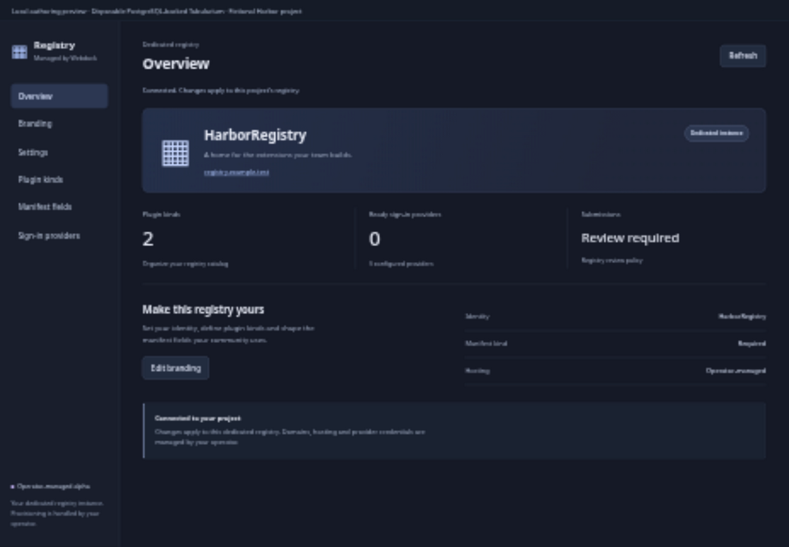
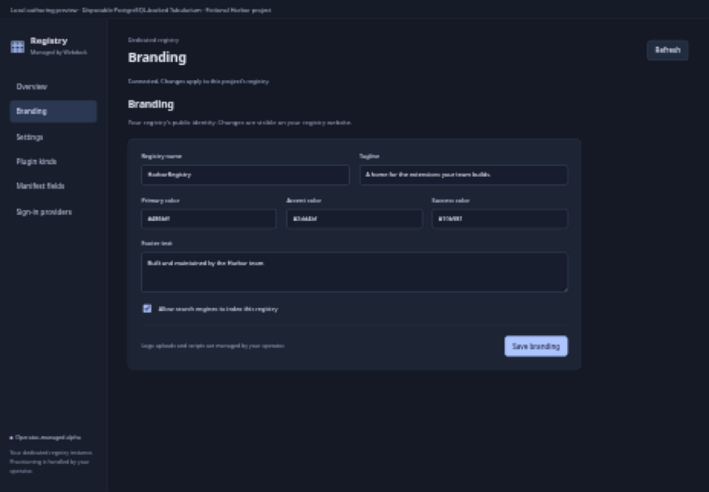

# Managed Registry

Manage a dedicated [Tabularium](https://github.com/tabularisdb/tabularium) plugin registry from your Webdock project. This is an **operator-managed alpha** (`0.1.0-alpha.1`): an operator provisions one Tabularium instance per Webdock project and connects it through a project-scoped Webdock HTTP binding.

The plugin manages the connected instance. It does not automatically create hosting, databases, domains or OAuth applications. Existing registries can be connected as the first pilot; never share a single registry admin binding between independent customer projects.

## Features

- Overview with registry identity, kind count, submission policy and provider readiness.
- Branding: name, tagline, three brand colors, footer text and search indexing.
- Settings: HTTPS documentation link, submission approval and manifest kind enforcement.
- List and create operator-approved plugin kinds; edit labels, descriptions, public-page visibility and per-kind manifest extensions.
- Read and replace global manifest extensions using bounded JSON Schema maps.
- Read sanitized GitHub, GitLab and Gitea provider readiness. OAuth secrets and client IDs are never returned.
- Every action is available through the project UI, Webdock API and MCP.

Logo uploads, analytics scripts, provider credentials, rate limits and infrastructure are operator-owned. Kind edits preserve existing operator copy, translations and examples. Tabularium kind updates replace a complete definition: avoid concurrent operator and Webdock edits to the same kind during the pilot.

## Screenshots

Local authoring preview with a fictional Harbor project and a disposable registry; these images do not show a production installation.





## Operator setup

1. Provision a dedicated Tabularium instance with HTTPS. The live-provider smoke check uses Tabularium `0.25` backed by PostgreSQL `18`.
2. Create a Tabularium PAT with precisely these scopes:

   ```text
   admin:branding:read
   admin:branding:write
   admin:instance:read
   admin:instance:write
   admin:kinds:read
   admin:kinds:write
   admin:manifest:read
   admin:manifest:write
   admin:provider-instances:read
   ```

3. Store that PAT in a **host-managed** HTTP binding named `registry`, scoped to this plugin installation, project and runtime generation. The host injects the PAT; the plugin never receives it. Enforce the HTTPS destination and fixed routes below. Never permit arbitrary paths, redirects to another origin, wildcard admin routes, cookies or forwarded user authorization.
4. Set operator configuration (the registry origin cannot be changed through an action):

   ```json
   {
     "registry_origin": "https://registry.example.com",
     "allowed_kind_keys": ["extension", "theme"]
   }
   ```

5. Allow only these upstream methods and paths in the binding. No trailing slash is needed:

   | Method | Path |
   | --- | --- |
   | GET, PUT | `/api/admin/branding` |
   | GET, PUT | `/api/admin/instance` |
   | GET, POST | `/api/admin/kinds` |
   | PUT | `/api/admin/kinds/extension` |
   | PUT | `/api/admin/kinds/theme` |
   | GET, PUT | `/api/admin/manifest/extensions` |
   | GET | `/api/admin/provider-instances` |

   Replace the example kind PUT paths with exact entries for each approved `allowed_kind_keys` value. Both the action validator and host binding must enforce this list. POST creation uses a fixed route and the action validates the key against the same operator configuration. Empty `allowed_kind_keys` permits read-only kind management.

6. Mount runtime TLS cert/key files and inject:

   ```text
   WEBDOCK_PLUGIN_RUNTIME_TOKEN=<host-generated 32+ character credential>
   WEBDOCK_PLUGIN_HOST_URL=https://api.webdock.dev
   WEBDOCK_PLUGIN_CONSOLE_ORIGIN=https://console.webdock.dev
   WEBDOCK_PLUGIN_HOST_PUBLIC_KEY=<host Ed25519 public key PEM>
   WEBDOCK_PLUGIN_GENERATION=<positive installation generation>
   WEBDOCK_PLUGIN_TLS_CERT=/run/tls/cert.pem
   WEBDOCK_PLUGIN_TLS_KEY=/run/tls/key.pem
   ```

`WEBDOCK_PLUGIN_HOST_URL` is the trusted callback API origin for host services. `WEBDOCK_PLUGIN_CONSOLE_ORIGIN` is the separate browser Console origin permitted to embed the UI; it must be a canonical HTTPS origin without a trailing slash, path, credentials, query or fragment. Both values are supplied by the operator, never by the incoming request.

The private runtime listens on **HTTPS 3443**. Only the host should reach it. Public static UI listens on **3444** and must be exposed over HTTPS by the operator’s reverse proxy. `/healthz` reports protocol, plugin, generation and version. The static UI receives a nonce-bound MessagePort from the host; it makes no direct provider or runtime requests.

A runtime action needs the expected runtime bearer credential and a short-lived signed `x-plugin-invocation` claim for the exact plugin, generation, project and action. The request host origin must match the configured host origin. The host rechecks installation and project authority when servicing the scoped HTTP binding. Inputs have no project, tenant, origin, token or provider selectors.

## API and MCP

See `tabularium.json` for strict input schemas, action capabilities, API paths and MCP names. API paths are relative to the host’s plugin API mount; API bodies and MCP arguments use the declared action inputs.

| Action | API | MCP |
| --- | --- | --- |
| `registry.overview` | `GET /overview` | `overview` |
| `registry.branding.read` | `GET /branding` | `branding_read` |
| `registry.branding.update` | `PUT /branding` | `branding_update` |
| `registry.settings.read` | `GET /settings` | `settings_read` |
| `registry.settings.update` | `PUT /settings` | `settings_update` |
| `registry.kinds.list` | `GET /kinds` | `kinds_list` |
| `registry.kinds.create` | `POST /kinds` | `kinds_create` |
| `registry.kinds.update` | `PUT /kinds` | `kinds_update` |
| `registry.extensions.read` | `GET /manifest/extensions` | `extensions_read` |
| `registry.extensions.update` | `PUT /manifest/extensions` | `extensions_update` |
| `registry.providers.list` | `GET /providers` | `providers_list` |

Read actions accept `{}`. Updates accept only declared fields; unknown fields are rejected. Branding inputs are `name`, `tagline`, `primary_hex`, `accent_hex`, `success_hex`, `footer_text` and `allow_indexing`. Settings inputs are `docs_external_url`, `require_approval` and `manifest_require_kind`. Branding excludes scripts, HTML injection settings and logo URLs. Documentation links require HTTPS without embedded credentials.

`registry.kinds.create` accepts `key`, `label`, optional `description` and `public_page_enabled`. Add per-kind manifest fields afterward through `registry.kinds.update`, which additionally accepts `extensions_schema_json`. Global updates accept `extensions_json`. These JSON fields are **strings**, for example:

```json
{"extensions_json":"{\"category\":{\"type\":\"string\",\"maxLength\":80}}"}
```

Pass an empty string or the JSON string `"{}"` to clear custom fields. Null inputs are rejected. Use an empty string to clear `footer_text`, `docs_external_url` or a kind’s `description`. Schema strings are limited to 32 KiB, 12 nested levels and 2,500 nodes. Prototype keys and external `$ref`, `$dynamicRef` and `$recursiveRef` references are rejected. Tabularium performs final schema validation and keeps its core manifest fields locked. The UI displays all provider and registry values as text.

## Development

Use Bun `1.4.3` and Node `24`. The SDK tarball is vendored from the matching Webdock workspace for reproducible external installs.

```sh
bun install --frozen-lockfile --ignore-scripts
bun run build
bun test
```

`src/registry.ts` exports `registryAction(ctx, action, input, {projectID, origin, allowedKindKeys})` for real-provider integration checks. It uses only `ctx.http.request` on the host binding `registry`. The security suite covers strict inputs, unsafe schema data, provider redaction, exact kind approval, complete kind preservation and signed runtime checks. A real provider smoke test may be run separately with operator-provided configuration.

The image in `tabularium.json` is pinned to the published alpha digest. Release manifest and universal descriptor contain identical bytes. No Kubernetes, SQL, database or provider credentials belong in this plugin or its configuration.

## Local acceptance

```sh
bun run test:provider # disposable Tabularium 0.25 + PostgreSQL 18; requires Docker
bun run test:image    # locally built webdock-managed-registry:0.1.0-alpha.1
bun run preview       # 127.0.0.1:3480, real disposable provider behind signed runtime actions
```

The preview is an authoring harness, not an installed Core deployment. It creates only labeled local containers and removes them on SIGINT/SIGTERM. English screenshots show a fictional Harbor project. Native-browser verification saved branding through the sandboxed MessagePort UI and reloaded it from PostgreSQL. Save controls deliberately avoid native form submission because the Core iframe allows scripts without enabling forms.
